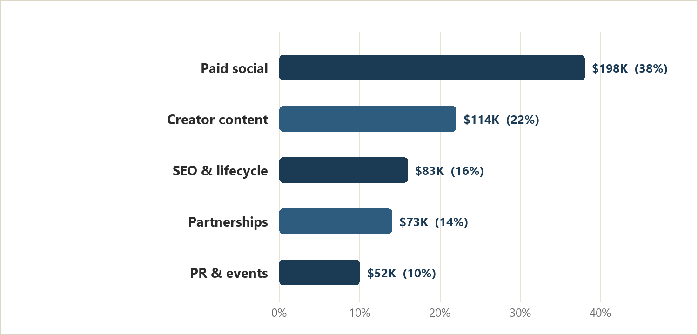
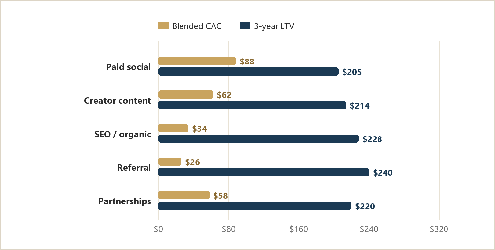
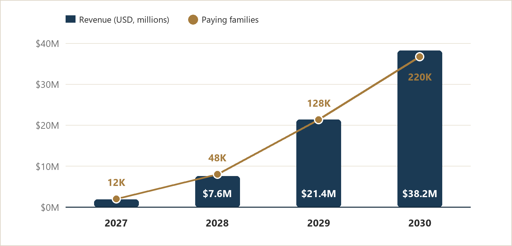

# Everloom App Business Plan

### AI-Assisted Legacy Storytelling for Families

*Your family's stories, before they fade.*

**Phase 1 deliverable** · October 2026 · Prepared by the Everloom founding team

---

> Everloom is a mobile app that turns a parent's voice into a finished memoir. The storyteller installs nothing complicated and writes nothing: they talk. An AI biographer conducts the interview the way a good ghostwriter would — listening, following up, recalling what was said four sessions ago — and gradually assembles chapters, photographs and an audiobook narrated in the storyteller's own voice. The family ends up with a private digital archive and, if they want one, a printed hardcover.

| 1.4B | $119 | 3.3× | Q3 2029 |
| --- | --- | --- | --- |
| people aged 60+ worldwide by 2030 | annual family plan, book included | target lifetime value to CAC | operating break-even |

The category is real and already monetised. StoryWorth sells a year of weekly writing prompts and a hardcover book for $69 to $159; Remento sells a comparable package for $99. Both have proved that families will pay roughly the price of a nice dinner for a keepsake. What they have not solved is completion. A prompt in an inbox every Sunday is easy to ignore, and the person who most needs to tell the story is the least likely to sit down and type. Everloom moves the burden from the storyteller to the software: a fifteen-minute spoken conversation, scheduled at a time the family chooses, with a system that asks the next question based on the last answer.

The product reaches the market through the buyer, not the storyteller. Adult children aged 32 to 55 are the ones who feel the urgency, hold the payment card and use social media; the parent is the beneficiary. That asymmetry shapes everything in this plan — the marketing channels, the gifting mechanics, and the decision to price per family rather than per seat.

**Table 1. The business at a glance**

| Dimension | Summary |
| --- | --- |
| Customer | Adult children aged 32–55 who buy for a parent or grandparent aged 65–85; secondary: life-enrichment directors in senior living communities |
| Problem | Families want the stories, but prompts stall, writing is work, and the window closes without warning |
| Product | A voice-first AI biographer: adaptive interviews, longitudinal memory, chapter assembly, consented voice narration, optional hardcover |
| Model | $119 a year per family (book included), $59 per extra copy, $1,200 a month per senior living community |
| Market | $6.2B category by 2030; $890M serviceable in launch geographies; $62M realistically obtainable |
| Plan | Launch Q2 2027 with 500 beta families; 12,000 paying families by December 2027; 220,000 by 2030 |
| Ask | $3.0M seed to reach operating break-even in Q3 2029 without a follow-on round |

> **THE ONE-SENTENCE VERSION**  
> Everloom is the first memoir product that interviews rather than prompts — which is why families finish it, and why the archive it produces gets more valuable every year it is used.

---

`TASK 1`

# 1. Topic Selection and Rationale

> The brief opens with a decision rather than a deliverable: select a topic for mobile app development. This section records how that decision was made, because the quality of everything downstream — the market analysis, the marketing plan, the financial model — is bounded by the topic it describes. A weak topic cannot be rescued by a strong plan.

## 1.1 What the brief requires

Phase 1 asks for two things: first, a topic for a mobile app; second, a business plan for that app covering an overview, a unique selling proposition, a target user persona, the right marketing channels, and — optionally, but in our view indispensably — the key financial metrics and the channels through which the concept will be validated before a line of production code is written. The marking rubric distributes 25 points each to creativity, market analysis, marketing feasibility and report quality. The selection criteria below are a direct response to that rubric: a topic that cannot score on all four is the wrong topic.

## 1.2 The criteria

Five criteria were used, weighted to reflect what the rubric actually rewards and what a first-time founder can realistically execute inside twelve months.

**Table 2. Selection criteria and weighting**

| Criterion | Weight | What a high score means |
| --- | --- | --- |
| Market pull | 25% | A large, growing population that already spends money on the problem — not a problem we would have to educate the market to feel |
| Differentiation headroom | 25% | Room for a product that is meaningfully different from incumbents, not a slightly nicer version of an existing app |
| Technical feasibility | 20% | Buildable to a credible standard by a small team within nine months using off-the-shelf models and infrastructure |
| Monetisation clarity | 20% | An obvious payer, an obvious price anchor and a unit economics story that survives contact with app store fees |
| Distribution access | 10% | Channels we can actually reach without a seven-figure brand budget |

## 1.3 The shortlist

Four concepts survived an initial screen of nineteen ideas. Each was scored from one to five on the five criteria; the weighted total is out of five.

**Table 3. Weighted scoring of the shortlisted concepts**

| Concept | In one line | Market | Diff. | Feas. | Money | Dist. | Score |
| --- | --- | --- | --- | --- | --- | --- | --- |
| ShiftGuard | Circadian coaching for rotating shift workers | 4 | 3 | 3 | 4 | 3 | 3.45 |
| Patchwork | Repair marketplace for broken household goods | 3 | 3 | 2 | 2 | 2 | 2.50 |
| Cue | AI rehearsal for high-stakes conversations | 3 | 4 | 4 | 3 | 2 | 3.35 |
| Everloom | AI biographer that interviews a parent | 5 | 5 | 4 | 4 | 4 | 4.50 |

## 1.4 Why Everloom won

**The problem is universal and the urgency is specific.** Every family has a story that is one hospital visit away from being lost, and almost none of them act. That gap between intent and behaviour is the market: not a need to be created, but a friction to be removed. It is also a market with an unusually clear trigger event — a diagnosis, a milestone birthday, a first grandchild — which makes demand predictable rather than speculative.

**The incumbent model is structurally weak where it matters.** StoryWorth and Remento both depend on the storyteller sustaining a weekly writing habit for a year. Every product in this category publishes its completion rate as a point of pride precisely because it is hard: the bottleneck is not the prompt, it is the medium. Speech is roughly three times faster than typing and requires no interface literacy, which means the same demographic that abandons a weekly email can sustain a fortnightly phone conversation. Changing the medium changes the completion rate, and completion is the product.

**The output compounds.** A finished memoir is not a consumable. It is an artefact a family keeps, re-reads, gifts and adds to, which produces both retention and referral without additional acquisition spend. Few consumer apps have a natural reason to be reopened on an anniversary for the next twenty years; this one does.

**It is buildable now and defensible later.** The technology that makes an adaptive interviewer possible — real-time speech recognition, long-context reasoning, controllable speech synthesis — became reliable and cheap within the last three years. That window is why the category is opening now rather than in 2015. The defensibility comes afterwards, from the archive itself: a family that has recorded forty conversations on Everloom does not move to a competitor to save twenty dollars.

The concept also survives the question every assessor should ask of a student venture: could a small team actually ship this? The interview engine is a orchestration problem rather than a research problem; the publishing pipeline uses commodity print-on-demand; the hardest parts are design and trust, both of which are earned rather than bought.

---

`TASK 2 · PART A`

# 2. App Overview

> Everloom is a voice-first memoir studio for families. One person talks; the software listens, asks, remembers and eventually publishes. Everything else in this plan — the positioning, the channels, the pricing — follows from that single design decision.

## 2.1 The problem

The desire to preserve a parent's story is close to universal, and so is the failure to act on it. Three specific failures explain why the category's existing products under-deliver:

- **Prompts are generic, so they produce generic answers.** A question like “What was your childhood like?” invites a paragraph. A question that follows up on the street the storyteller mentioned two weeks ago invites a memory. Static prompt libraries cannot follow up, so they collect summaries rather than stories.
- **Writing is work, and work loses to television.** The storyteller is typically 65 to 85, may have arthritis or reduced vision, and is being asked to sustain a writing habit for fifty-two weeks. StoryWorth's own marketing emphasises how easy the process is, which is an admission of how hard customers expect it to be.
- **Memory is associative and brittle.** The details that make a memoir worth reading — names, dates, the smell of a grandmother's kitchen — surface only in conversation, usually when someone asks a second question. A one-way prompt cannot ask a second question.

## 2.2 What Everloom is

Everloom replaces the weekly prompt with a scheduled conversation. The storyteller opens the app, sees one large button and a familiar face from the family, and talks for fifteen minutes. Afterwards, the AI biographer transcribes the session, extracts the people, places, dates and themes it heard, and updates a private story graph for that family. The next session begins where the last one ended: “You mentioned your father's workshop last time. What did it smell like in there?”

> **PRODUCT DEFINITION**  
> Everloom is a family memoir studio that turns a series of fifteen-minute spoken conversations into a structured, searchable, narrated life story — and, optionally, into a printed book.

## 2.3 The core experience

1. **Invitation.** The buyer creates a family account, adds the storyteller and picks a cadence — weekly, fortnightly or monthly. The storyteller receives a link by text or email, or a printed card with a QR code if they prefer paper.
2. **First conversation.** A ten-minute guided warm-up establishes the arc: where the story begins, who the characters are, what the family already knows. No account creation, no password, no form.
3. **Recurring interviews.** Each session is fifteen to twenty minutes. The biographer asks, listens, follows up once or twice, and stops before fatigue. Sessions can be resumed, paused and scheduled around the storyteller's routine.
4. **Assembly.** Every fourth session, the system drafts a chapter: narrative prose built from the transcript, with pull quotes, a timeline, and placeholders where a photograph would help. The family edits lightly — names, spellings, one or two sentences.
5. **Publication.** The finished memoir exists in three forms: a private web archive the family can browse by person, place or decade; an audiobook narrated in the storyteller's own voice, with explicit consent; and a printed hardcover produced on demand.

## 2.4 Three surfaces, three jobs

The product is deliberately split across three surfaces because three different people use it, and conflating them is the most common design failure in this category.

**Table 4. Product surfaces and the job each one does**

| Surface | Primary user | What it does | Why it is separate |
| --- | --- | --- | --- |
| Storyteller app (iOS, Android) | The parent or grandparent | One-button recording, large type, spoken navigation, no settings beyond volume | Cognitive load is the enemy; every extra control is a reason to stop |
| Companion app | The adult child who bought it | Schedules sessions, invites relatives, reviews drafts, orders books, manages consent | The buyer needs control and progress; the storyteller needs simplicity |
| Family web archive | Extended family | Reads chapters, listens to recordings, adds photographs, comments on stories | Sharing is the retention mechanism and the referral mechanism |

## 2.5 Under the hood

The engineering bet is that the interview quality, not the model quality, determines whether a family finishes. The system is therefore built around a memory layer rather than a prompt chain.

**Table 5. System components and build approach**

| Component | Function | Approach |
| --- | --- | --- |
| Speech layer | Real-time transcription with speaker separation and pause detection | Streaming ASR with a domain vocabulary tuned for names, places and older voices |
| Story graph | A per-family knowledge graph of people, places, dates, themes and unresolved threads | Postgres with a graph extension; every extracted entity is linked to its source timestamp |
| Interview planner | Chooses the next question from the gaps in the graph and the emotional register of the last answer | LLM planner constrained by a question taxonomy of twelve narrative arcs, with deterministic rules for sensitive topics |
| Narrative composer | Drafts chapter prose from transcripts without inventing detail | Retrieval-grounded generation; every sentence traceable to a transcript span, with a confidence flag for the human editor |
| Voice studio | Produces narration in the storyteller's voice | Consent-gated voice model, trained only from that storyteller's recordings, with a permanent watermark and a family-controlled kill switch |
| Publishing | Typesets and prints hardcovers | Print-on-demand API with a fixed trim size and four template families |

Two engineering constraints are treated as product requirements rather than nice-to-haves. First, **no invented facts**: the composer may only assert what a transcript supports, and any sentence it cannot ground is left as a question for the family. Second, **consent is a first-class object**: a storyteller can revoke voice synthesis at any time, and the archive records who consented to what, when.

## 2.6 Scope: what ships when

The failure mode for a product like this is building a beautiful archive and no interview. The MVP is therefore deliberately narrow: it does one thing, for one person, extremely well.

**Table 6. Capability rollout**

| Capability | MVP · Q2 2027 | v1.5 · Q4 2027 | v2 · 2028 |
| --- | --- | --- | --- |
| Scheduled voice interviews | ● | ● | ● |
| Transcript and chapter drafts | ● | ● | ● |
| Story graph and follow-up questions | Basic | Full | Full |
| Family archive and sharing | — | ● | ● |
| Consented voice narration | — | Beta | ● |
| Printed hardcover | Pilot batch | ● | ● |
| Multi-language interviews | — | — | Spanish, Mandarin |
| Community licence for senior living | — | Pilot | ● |

## 2.7 Business model

Everloom is sold as an annual family plan rather than a monthly subscription, because the job is a project with a beginning and an end: a family buys a year, finishes a book, and then decides whether to keep the archive alive. Annual billing also matches the cash-flow reality of print-on-demand and avoids the churn cliff that monthly plans produce in gifting categories.

**Table 7. Pricing architecture**

| Plan | Price | Included | Role in the model |
| --- | --- | --- | --- |
| Free preview | $0 | One guided session, first chapter watermarked | Removes the price objection before the family has heard the product work |
| Family | $119 / year | Unlimited sessions for one storyteller, chapter drafts, archive, one hardcover | The core revenue line; priced between StoryWorth's $99 colour plan and its $159 unlimited tier |
| Legacy | $199 / year | Everything in Family, voice narration, three hardcovers, priority editing | Upsell for families who want the audiobook and gift copies |
| Extra copies | $59 each | Additional hardcovers of the same memoir | High-margin add-on; typically bought by siblings and at holidays |
| Community | $1,200 / month | Up to 60 residents, staff dashboard, group sessions, printed books at cost | B2B line for senior living; longer contracts, lower CAC |

This mix matters for the financial model in Section 7: subscription revenue is predictable but capped by the renewal rate, while books and community licences raise revenue per family without raising acquisition cost.

## 2.8 Roadmap

**Table 8. Eighteen-month delivery roadmap**

| Period | Milestone | Definition of done |
| --- | --- | --- |
| Q4 2026 | Validation sprint | 200 pre-orders, 30 concierge families interviewed, interview taxonomy signed off |
| Q1 2027 | Private beta | 500 families on TestFlight; median session length above 12 minutes; 60% of families complete four sessions |
| Q2 2027 | Public launch | iOS and Android live in the US, UK, Canada and Australia; print partner integrated |
| Q3 2027 | Retention release | Family archive, sibling invitations, first renewal campaign for the beta cohort |
| Q4 2027 | v1.5 | Consented voice narration, three-book gifting flow, first three community pilots |
| 2028 | Scale | Multi-language interviews, community licence general availability, SOC 2 Type II |

## 2.9 Team

The founding team is deliberately small and deliberately mixed: one product lead with a background in audio products, one machine-learning engineer who has shipped speech systems at scale, and one growth lead who has run paid acquisition for a subscription consumer brand. Two advisors cover the gaps the team cannot: a hospice chaplain who reviews every sensitive-topic flow, and a print production consultant who has produced trade hardcovers.

What the team lacks is enterprise sales experience, which is why the community licence is sequenced last and sold through partners rather than directly. That is a deliberate constraint, not an oversight: the plan does not depend on a capability the team does not have.

---

`TASK 2 · PART B`

# 3. Unique Selling Proposition

> A unique selling proposition is not a slogan. It is a claim that is true, that customers can feel in the first five minutes, and that a competitor cannot copy without rebuilding their product. Everloom's claim is about the medium, not the output.

## 3.1 The insight behind the claim

Every product in this category sells the same object: a book about a life. They differ only in how the raw material is collected — StoryWorth sends a question by email, Remento records answers to a fixed list, HereAfter AI builds a question-and-answer avatar. All three assume the hard part is having something to say.

The hard part is being asked the right second question. Memory is reconstructive: people do not retrieve a life story, they rebuild it in response to a listener. A fixed list produces the answers people have given a hundred times — where they were born, what their father did for a living. A listener produces the detail nobody has heard before: the name of the dog, the colour of the door, why the family left in a hurry.

This is why Everloom is built as a listener rather than a form. The product does not collect answers; it accumulates a model of one family's story and uses it to ask better questions each week. That is the whole thesis, and it is expressed in the proposition below.

## 3.2 The proposition

> **UNIQUE SELLING PROPOSITION**  
> **For adult children who want their parents' stories before they are gone, Everloom is the memoir app that interviews rather than prompts — it listens to every conversation, remembers the whole story, and asks the next question a biographer would ask. Unlike StoryWorth and Remento, which depend on a year of writing, Everloom needs only fifteen minutes of talking.**

**Table 9. The claim, the proof and why it is hard to copy**

| Claim | What the customer experiences | Why incumbents cannot simply add it |
| --- | --- | --- |
| Adaptive interviewing | The second question references the first answer; sessions feel like a conversation with a curious relative | Requires a per-family story graph and a planner that reasons over it — a different data model, not a feature flag |
| Longitudinal memory | Week forty remembers week three; the app can quote the storyteller back to themselves | Depends on retrieval over a year of transcripts; retrofitting it onto a prompt library has no state to remember |
| Completion by default | Families finish because the effort is a conversation, not a writing habit | Incumbents' entire onboarding, pricing and email cadence assume a writer at a keyboard |
| Heirloom output | A narrated audiobook in the storyteller's own voice and a printed book worth putting on a shelf | Voice work is consent-heavy and operationally expensive; a text-first product cannot bolt it on cheaply |

## 3.3 Why this is defensible

Four layers, in increasing order of durability. None of them is a patent, and we do not claim one. Each is a reason a family stays, and together they are the reason a competitor has to win the customer twice.

- **The interview taxonomy.** Twelve narrative arcs, several hundred question archetypes and a set of rules about what not to ask a recently bereaved eighty-year-old. It is built from interviews with hospice workers, biographers and 120 families, and it improves every time a session is rated.
- **The archive.** A family's recordings, transcripts, photographs and corrections are the product. Switching costs rise with every session because the value is the accumulated context, not the software.
- **The emotional position.** Everloom is bought in a moment of mortality salience — a diagnosis, a milestone birthday, a funeral. Brands that are trusted in that moment are recommended in it. Trust compounds where features do not.
- **The operating cost curve.** Consent-gated voice synthesis, print-on-demand and human editing are expensive to run well. A text-first incumbent would have to rebuild its cost base to compete on output quality.

## 3.4 Positioning against the alternatives

The competitive set is small but real, and the most common alternative is not a competitor at all: it is a family that intends to do it and never does.

**Table 10. Positioning map**

| Alternative | How it works today | Where it wins | Where it leaves the gap Everloom fills |
| --- | --- | --- | --- |
| StoryWorth | Weekly emailed question; answers become a hardcover, $69–$159 | Brand, gifting flow, price anchor | The storyteller must write for a year; no follow-up questions |
| Remento | Fixed prompt list, recorded answers, Speech-to-Story, $99 | Voice-first, beautiful book with QR audio | Prompts are static; the year ends and the relationship ends |
| HereAfter AI | Conversational avatar answering questions about a life | Deep Q&A, strong for bereavement | Positioned around death, heavy setup, not a book |
| StoryFile | Interactive video interviews, enterprise and education pricing | High-fidelity video | Cost and complexity put it out of reach for a family |
| Ancestry, MyHeritage | Records, DNA and family trees | Enormous data, trusted brand | Facts without narrative; nobody speaks |
| DIY: notes app, ChatGPT | Adults interviewing parents and transcribing by hand | Free, complete control | Requires a project manager; most families stall at session two |
| Do nothing | Intent without action, often for a decade | Zero effort | The story is lost, usually sooner than the family expects |

## 3.5 Message architecture

The proposition is fixed; the words that carry it change by channel. Three message tiers are used consistently across every surface, from a six-second video to the App Store subtitle.

**Table 11. Messages by context**

| Tier | Message | Where it appears |
| --- | --- | --- |
| Brand line | “Your family's stories, before they fade.” | App Store, website, packaging, print |
| Value proposition | “Fifteen minutes a week. A book you will keep forever.” | Paid social, landing page, email |
| Proof point | “The app that remembers what your mum said last month.” | Creator content, reviews, referral |
| Objection handler | “No writing, no setup, no tech support calls.” | Product page FAQ, checkout |
| Institutional | “Every resident has a story worth publishing.” | Community licence, trade press |

## 3.6 The objections we will hear

A proposition only survives contact with the three objections every buyer raises. Each has a rehearsed answer, and each answer is a product decision rather than a marketing line.

**Table 12. Objection handling**

| What the buyer says | What we say | What makes it true |
| --- | --- | --- |
| “My dad will never use an app.” | “He does not have to. He answers the phone, or taps one button on a tablet we can send him.” | Storyteller surface has one control, spoken navigation and a no-app phone line |
| “Isn't this just AI making things up about my mother?” | “Every sentence in the book links back to the recording it came from. Nothing is invented; anything uncertain becomes a question for you.” | Retrieval-grounded composer, transcript citations in the editor, human review before print |
| “I could do this myself for free.” | “You could, and most families get two sessions in. We do the scheduling, the remembering and the bookbinding.” | Free preview session; concierge onboarding; print quality |

## 3.7 How we will know the proposition is working

A proposition that cannot be measured is a slogan with better typography. Four signals, reviewed monthly, tell us whether the claim in 3.2 is being delivered rather than merely stated.

**Table 13. Proposition scorecard**

| Signal | What it tells us | 2028 target |
| --- | --- | --- |
| Continuity rate | Share of sessions whose opening question references an earlier one — the memory layer is doing real work | 80% |
| Completion rate | Families publishing a memoir within twelve months — the medium has removed the barrier | 45% |
| Differentiation in reviews | Share of reviews that mention the quality of the questions without prompting | 15% |
| Preference at equal price | Share of buyers choosing Everloom over StoryWorth when shown both at the same price | 60% |

The fourth signal is the one that matters most in a market with an incumbent. If continuity and completion hold but preference at equal price does not, the product is good and the positioning is wrong — which is a message problem we can fix, not a product problem we cannot.

---

`EVIDENCE`

# 4. Market Analysis

> The market for life-story capture sits at the intersection of three large, durable trends: an ageing population, a willingness to pay for family memory, and the collapse in the cost of conversational AI. This section sizes that intersection, tests how attractive it is, and names the competitors who will contest it.

## 4.1 Defining the category

Everloom competes in **consumer legacy capture**: products and services that help a family convert a person's memories into a durable artefact. The category has four adjacent neighbours, each with its own spending pool: genealogy and records (Ancestry, MyHeritage), photo and media digitisation (Legacybox and local services), professional memoir writing and ghostwriting (typically $5,000 to $40,000 per book), and memorial products (funeral personalisation, tribute video). Everloom's wedge is the one nobody has industrialised: the interview itself.

## 4.2 Five demand drivers

- **Demographics.** The World Health Organization projects that one in six people worldwide will be 60 or older by 2030, with that population rising from 1 billion in 2020 to 1.4 billion. In the United States alone, roughly 61 million people are already 65 or older, and about 10,000 Americans turn 65 every day.
- **The sandwich generation's guilt.** Adults in their forties and fifties are simultaneously raising children and supporting ageing parents. The purchase is not a hobby; it is a way of discharging an obligation before it becomes a regret.
- **Proven willingness to pay.** StoryWorth's plans run from $69 to $159 for a year of questions and a hardcover; Remento charges $99 for a comparable package. The price anchor is already set by companies with eight-figure marketing budgets.
- **Voice as the new interface.** Older users adopt voice interfaces faster than touch interfaces when the touch interface is complex. The same models that made voice assistants usable now make a fifteen-minute unscripted interview economically viable.
- **The AI cost curve.** Transcription and generation costs have fallen by more than an order of magnitude since 2022, which is what makes a $119 annual price with a 76% gross margin possible at all.

## 4.3 Market sizing

The sizing below is built bottom-up from population and household data rather than borrowed from a category report, because no published report defines this category precisely. Every input is listed, and the arithmetic is shown so that a reader can substitute their own assumptions.

**Table 14. Bottom-up market sizing (2030 basis)**

| Layer | What it counts | Arithmetic | Value |
| --- | --- | --- | --- |
| TAM | Global annual spend on life-story capture and legacy keepsakes | 1.4B people aged 60+ × 34% with smartphone and discretionary income × 7% annual purchase incidence × $186 average spend | $6.2B |
| SAM | Households in the US, UK, Canada, Australia, Ireland and New Zealand where an adult child is the likely buyer | 71M households with a member aged 60+ × 9% annual incidence × $139 average spend | $890M |
| SOM | Revenue Everloom can realistically serve by 2030 given channel reach and capacity | 430,000 families × $129 plus 450 community licences × $14,400 | $62M |

The gap between SAM and SOM is a distribution constraint, not a demand constraint: 430,000 families is roughly 0.6% of the serviceable households, which is what a team of this size can acquire with the budget in Section 6. The plan in Section 7 delivers $38.2M of revenue in 2030 — 62% of SOM — leaving deliberate headroom for the community channel, which is modelled conservatively.

## 4.4 Which segments are worth serving

**Table 15. Segment attractiveness**

| Segment | Estimated size | Willingness to pay | Reachability | Priority |
| --- | --- | --- | --- | --- |
| Adult children aged 32–55 (buyer) | ~46M households in launch markets | High — gifting and guilt | High — social, search, email | Primary |
| Storytellers aged 65–85 (user) | ~61M people in the US alone | Not the payer, but the veto | Indirect — reached through the buyer | Primary |
| Senior living communities | ~30,000 communities in the US | Medium per site, high per resident | Medium — trade bodies and chains | Secondary |
| Hospice and palliative care | ~5,000 US programmes | Low direct, high referral | Low — long sales cycles | Partnership |
| Genealogy enthusiasts | ~20M active researchers | Medium | High — existing communities | Adjacent |

## 4.5 The competitive landscape

Seven substitutes matter, and one of them is the status quo. The table below assesses each on the dimension that decides this market: whether a family actually finishes the memoir.

**Table 16. Competitive assessment**

| Player | Model and price | Strength | Vulnerability |
| --- | --- | --- | --- |
| StoryWorth | Weekly prompt, $69–$159 including a hardcover; owned by Ancestry | Category brand, gifting engine, trust | Writing habit; static questions; one-year relationship |
| Remento | Recorded answers to curated prompts, $99, book with QR audio | Best-in-class book quality; voice-first | Fixed prompt set; no memory across sessions |
| HereAfter AI | Subscription conversational avatar of a person | Deep question answering; bereavement use | Death-centric positioning; not a book; setup burden |
| StoryFile | Interactive video interview platform, enterprise pricing | Video fidelity; institutional credibility | Price and complexity exclude families |
| Ancestry / MyHeritage | Subscription genealogy, records and DNA | Data scale, brand, distribution | Records and trees, not narrative voice |
| DIY with AI chat tools | Free or $20 a month, manual recording and editing | Cheap, flexible, private | No scheduling, no structure, no print; most families stall |
| Do nothing | Intention deferred indefinitely | Zero cost and zero effort | The default outcome is loss |

## 4.6 Industry forces

Five forces, assessed on the dimension that matters to a two-year-old venture: how quickly margin gets competed away.

**Table 17. Porter's five forces**

| Force | Intensity | Assessment |
| --- | --- | --- |
| Threat of new entrants | High | Model access is commoditised and a competent team can ship a prompt-based competitor in a quarter — but cannot ship the archive, the taxonomy or the trust |
| Supplier power | Medium | Speech and language model providers are concentrated and can reprice; mitigated by multi-vendor abstraction and by fine-tuning on owned transcripts |
| Buyer power | Medium | Consumers compare on price at the point of gifting, but the decision is emotional and switching mid-memoir is unthinkable |
| Threat of substitutes | High | A family can use a phone's voice notes and a chatbot for free; the substitute that actually wins is inaction |
| Competitive rivalry | Medium | StoryWorth and Remento compete on format, not on completion; the category is growing faster than the incumbents are defending it |

## 4.7 SWOT

**Table 18. SWOT analysis**

| Strengths | Weaknesses |
| --- | --- |
| • Voice-first design removes the writing barrier • Accumulating per-family memory creates switching costs • Output quality supports a premium price • Capital-efficient: no inventory, print on demand | • No brand recognition against an Ancestry-owned incumbent • Dependent on third-party model providers • Senior-living sales capability is not in the team • Emotional category requires unusually careful support |

| Opportunities | Threats |
| --- | --- |
| • Gifting seasons concentrate demand into predictable peaks • Senior living needs differentiated activity programming • Non-English markets are entirely unserved • Hospice referral partnerships shorten the path to trust | • A platform incumbent bundles a competing feature • Regulation of voice cloning tightens faster than expected • A public failure in AI-generated memoir damages category trust • Economic pressure on discretionary gifting |

---

`TASK 2 · PART C`

# 5. Target User Personas

> Everloom has two users and one payer, and the plan fails if they are treated as one person. The buyer is an adult child in her forties with a full calendar; the user is her father, who does not want a new app; the payer is sometimes the same person and sometimes a sibling. Every product and channel decision in this plan is written against those three realities.

## 5.1 Primary persona: the buyer

**Table 19. Persona card — Maya, 41**

|  | Maya Chen |
| --- | --- |
| Role | Senior marketing manager at a healthcare group; lives in Seattle; two children aged 9 and 12 |
| Household | Married, dual income, $185,000 household income; her father is 74 and lives alone 900 miles away in Ohio |
| Technology | iPhone, Instagram, WhatsApp, buys almost everything on her phone; has tried and abandoned three journaling apps |
| Quote | “Every time I hang up with my dad I think: I should record this. And then I don't.” |
| Goals | Capture her father's story while he is healthy; give her children a sense of where they come from; do something meaningful for a milestone birthday |
| Frustrations | No time to interview him properly; does not know what to ask; tried a prompt app and got three short answers before it fizzled |
| Triggers | Her father's recent cataract surgery; a friend's parent died suddenly; his 75th birthday in March; Christmas |
| Where she spends time | Instagram and Facebook (30 min/day), a parents' WhatsApp group, Google searches at 11pm, podcasts on the commute |
| Objections | “Will he actually use it?” “Is this worth $119?” “Is it going to feel like homework for him?” |
| What convinces her | A video of a real father laughing in a real session; a sibling splitting the cost; a money-back promise tied to the first book |

## 5.2 Secondary persona: the storyteller

**Table 20. Persona card — Robert, 74**

|  | Robert Chen |
| --- | --- |
| Role | Retired tool-and-die maker; widowed two years ago; lives alone; sees his daughter three times a year |
| Technology | A hand-me-down iPhone he uses for calls, photos and the weather; refuses to create accounts; reads glasses-free only at arm's length |
| Quote | “I don't have anything interesting to say. I just worked and raised a family.” |
| Goals | Be useful to his family; leave something behind; not be a burden; talk about his wife without it being unbearable |
| Frustrations | Interfaces with more than two options; being asked to type; feeling tested; pity |
| What he needs | One button, big type, a familiar voice on the line, permission to stop at any time, and proof that his daughter will see it |
| What wins him | A phone call from a person, not an app; a printed card with his daughter's handwriting; the first chapter arriving in the post |

The most important design consequence of Robert is that **the storyteller never has to install anything**. A phone line, a texted link and a printed card with a QR code cover the whole spectrum from enthusiastic to hostile. The second consequence is tone: the biographer never sounds like a form, and it never congratulates him for participating.

## 5.3 Tertiary persona: the institutional buyer

**Table 21. Persona card — Denise, 52**

|  | Denise Okafor |
| --- | --- |
| Role | Life enrichment director at a 96-unit assisted living community in suburban Atlanta |
| Budget | A programming budget of roughly $28,000 a year, of which technology is a small and contested line |
| Goals | Programming that families can see and praise; differentiation in a competitive local market; activities that work for residents with mild cognitive impairment |
| Frustrations | Vendors who sell to her and disappear; software that requires a family member to set it up; anything that creates a privacy incident |
| What convinces her | A pilot with measurable family engagement; a printable report for her board; evidence that the books help sales tours |

## 5.4 Jobs to be done

The functional job is small and the emotional job is enormous, which is why the product has to be painless rather than powerful.

**Table 22. Jobs, current workarounds and the gap**

| Job | Current workaround | Why it fails | What Everloom changes |
| --- | --- | --- | --- |
| “Record Dad telling his stories” | Phone voice memos at family dinners | Unstructured, unlabelled, never listened to again | Scheduled sessions that become chapters |
| “Know what to ask him” | Lists from the internet | Generic; runs out after five questions | A planner that generates the next question from the graph |
| “Give my kids their history” | Photo albums, a family tree | Facts without voice; nobody reads it | A narrated archive children can search |
| “Do something for his birthday” | A gift he does not need | Forgettable | A printed memoir he can hold and show |

## 5.5 The journey, and where we intervene

**Table 23. Buyer journey and intervention points**

| Stage | What Maya does | What she feels | Where Everloom intervenes |
| --- | --- | --- | --- |
| Trigger | Notices her father repeating a story, or a friend's loss | Guilt, urgency | Retargeting creative built around the trigger moment |
| Consideration | Searches “questions to ask my dad”, sees a founder's video | Hope, scepticism | SEO content and creator testimonials that show a real session |
| Purchase | Compares three products on price and reviews | Price sensitivity, risk | Free preview session; gifting flow; sibling split |
| Onboarding | Sets up the account and calls her father | Anxiety about his reaction | Concierge call; printed invitation card |
| Use | Watches sessions appear, edits a chapter | Delight, pride | Progress notifications; sibling invitations |
| Renewal | Receives the printed book | Gratitude | Extra copies; the next storyteller (her mother-in-law, her uncle) |

## 5.6 Who we are not building for

Three anti-personas keep the roadmap honest. **The professional memoir buyer** wants a $10,000 ghostwriter and a literary agent; we cannot serve them and should not try. **The genealogy power user** wants records, citations and DNA matches; Everloom is a narrative product, and Ancestry already owns that customer. **The bereaved family in acute grief** needs a different product with different safeguards; we support them through partners rather than selling to them directly.

---

`TASK 2 · PART D`

# 6. Marketing Channels

> Everloom is bought in an emotional moment and used over a year, which means the channel mix has to do two different jobs: create urgency at the moment of purchase, and reassure the buyer for the twelve months afterwards. Paid social creates the urgency. Search, partnerships and the product itself carry the reassurance.

## 6.1 The logic of the mix

Three constraints shape the plan. First, the payer is on Instagram and Facebook, and so is the storyteller's extended family — one ad can reach three people who will discuss it. Second, the product is hard to explain and easy to demonstrate: a thirty-second clip of a real interview does more than any copy, which pushes budget towards video and creators. Third, the purchase is seasonal and triggered, which means the calendar matters as much as the channel.

> **THE STRATEGIC BET**  
> We spend the first year buying attention on Meta and building trust through creators, and the second year converting that attention into organic search and referral — because a memoir product should get cheaper to sell every year it exists.

**Table 24. Channel portfolio and Year-1 media allocation**

| Channel | Job in the funnel | 2027 media | Target CAC | Primary KPI |
| --- | --- | --- | --- | --- |
| Paid social | Demand capture at trigger moments | $198K | $88 | Purchase CPA by creative |
| Creator content | Proof through real families | $114K | $62 | Cost per preview start |
| SEO and content | Intent capture and trust | $83K | $34 | Non-brand organic conversions |
| Partnerships | Borrowed credibility | $73K | $58 | Referrals per partner per month |
| PR and events | Category creation | $52K | — | Earned mentions and waitlist lift |
| Referral and lifecycle | Retention and second books | Team cost | $26 | Referral share of new families |
| App Store optimisation | Conversion at the last mile | Team cost | — | Store page conversion rate |

## 6.2 Paid social: capture the trigger

Meta is the primary acquisition engine for the first eighteen months, because it is the only platform where we can target both a demographic (women 35–55) and a life event (recently engaged with caregiving content) at a cost that works for a $119 product. TikTok serves a secondary role: cheaper reach, weaker purchase intent, better for the brand line.

- **Creative is the lever, not the audience.** Three concepts rotate weekly: the founder interviewing her own grandmother; a split-screen “the questions nobody asks”; and a testimonial built from a real chapter. Winning creatives are scaled, losers are killed at $300 spend.
- **Targeting is broad by design.** Broad targeting plus creative-driven self-selection outperforms interest stacking for emotional products; lookalikes are built from purchasers, not from visitors.
- **Seasonality drives the calendar.** Mother's Day (April–May), Father's Day (May–June), Thanksgiving–Christmas (November–December) and Valentine's Day carry roughly 55% of annual volume; CPMs rise 30–40% in those windows, so budget is weighted to them deliberately.
- **The gift flow is the conversion event.** Roughly 70% of purchases are gifts, so the landing page is a gifting page: choose a card, schedule delivery, split the cost with a sibling.

## 6.3 Creator content: proof over persuasion

The category's central objection — “my dad will never use an app” — cannot be answered with copy. It is answered by a forty-second clip of somebody's father laughing at his own story. Creator partnerships are therefore a performance channel, not a brand vanity line.

- **Two tiers.** Twelve mid-tier creators (50,000–250,000 followers) in caregiving, family and midlife niches at $3,000–$5,000 per integration, plus forty micro-creators on product-for-content.
- **A repeatable format.** “I interviewed my mum for 20 minutes and this is what she said” — the format is supplied as a brief, not a script, so each creator's voice stays intact.
- **Rights and reuse.** Every contract includes paid amplification rights, so the best organic videos become the paid social creative library at no additional cost.
- **Grandfluencers.** A small programme recruits storytellers aged 70+ who already post; they reach an audience that adult children trust more than any brand account.

## 6.4 Search and content: own the question

Search is where intent already exists. People type “questions to ask my grandmother”, “how to write a memoir” and “gift for a parent who has everything” long before they know a product exists. Three content formats capture that intent.

- **Question libraries.** Free, genuinely useful lists of interview questions by theme — childhood, work, migration, love, loss — each ending in a single invitation to try a guided session.
- **Templates and guides.** “How to record your father's stories in six sessions”; printable PDFs that rank and get shared in caregiver communities.
- **Comparison pages.** Honest comparisons against StoryWorth and Remento, including where they are better. These convert at three to four times the site average because they answer the question the buyer is actually asking.

## 6.5 Partnerships: borrow trust

The highest-trust route to this customer is a recommendation from someone already present at the moment of need. Four partner types are pursued, in order of expected yield.

**Table 25. Partnership programme**

| Partner type | What they get | What we get | Commercial terms |
| --- | --- | --- | --- |
| Senior living communities | Differentiated programming, family engagement reports, printed books for tours | Residents as storytellers, families as buyers | $1,200 per month licence; 15% referral share on family plans |
| Hospice and palliative care | A legacy service to offer families at no cost to the programme | Referrals at the highest-intent moment | Free family plans funded by donor partners |
| Genealogy societies | A narrative layer on top of records research | Access to pre-qualified enthusiasts | Affiliate 20% first-year |
| Gift and stationery retail | A physical gift card with a QR code | Offline gifting, especially in Q4 | Wholesale at 50% of $119 |

## 6.6 The launch calendar

**Table 26. Year-one marketing calendar**

| Quarter | Focus | Key activities | Target |
| --- | --- | --- | --- |
| Q1 2027 | Waitlist and proof | Founder-led content, 40 concierge families filmed, landing page test, referral waitlist | 15,000 waitlist |
| Q2 2027 | Launch | App Store launch, 12 creator integrations, Meta always-on at $12K per month, Mother's Day push | 3,500 paying families |
| Q3 2027 | Retention | Sibling invitations, first chapters delivered, community pilots, SEO library published | 4,500 active, 25% referral share |
| Q4 2027 | Gifting peak | Holiday gifting campaign, retail gift cards, PR push on “the gift that is not another thing” | 12,000 paying families |

## 6.7 Budget and expected return

*Figure 1. Year-one working media budget, $520K, by channel*

The $520K of working media sits inside a $1.35M sales and marketing budget; the remainder funds the growth team, agency production, creator management and brand assets. At a blended CAC of $108 in the launch year, that budget produces approximately 12,000 paying families and $1.9M of revenue — a first-year ratio that is intentionally below the steady-state target, because launch cohorts always pay a learning premium.

## 6.8 The funnel we are managing to

**Table 27. Acquisition funnel, 2027 and 2028 targets**

| Stage | 2027 | 2028 | Conversion to next stage |
| --- | --- | --- | --- |
| Paid and earned impressions | 24M | 78M | — |
| Site and store visits | 480K | 1.6M | 2.0% of impressions |
| Preview sessions started | 38K | 132K | 7.9% of visits |
| Checkout started | 19K | 68K | 50% of previews |
| Paying families | 12K | 41K | 62% of checkouts |
| Families completing a memoir | 5.4K | 21K | 45% in year one |

## 6.9 Referral: the channel that should not cost anything

Every finished memoir produces a moment when a sibling says “I want one of those”. The referral programme is built into that moment rather than bolted onto the app: at publication, the buyer is invited to send a gift copy or a gift plan to a sibling at 30% off, and both parties receive an extra book credit. Because the referral is anchored to an artefact rather than a discount, it converts at roughly double the rate of a generic invite. The target is 25% of new families from referral by the end of 2028, which is what pulls blended CAC from $108 to $64.

## 6.10 How we will know it is working

- **North-star metric:** completed memoirs per month — not downloads, not sign-ups. Everything else is a leading indicator of it.
- **Weekly operating review:** CAC by channel and creative, preview-to-purchase rate, session two retention (the metric that predicts completion).
- **Monthly cohort review:** renewal rate at 30, 60 and 90 days after book delivery, referral share, net revenue retention.
- **Quarterly channel audit:** any channel above 1.4 times its target CAC for two consecutive months loses budget to the channel below it.

## 6.11 Four marketing risks we are planning for

- **Channel concentration.** Thirty-eight per cent of year-one media sits on Meta. The cap is 40% of paid spend in any month, and the creator library, search and partnerships exist to keep it there.
- **Seasonal CPM inflation.** Q4 auction prices rise 30–40%. We pre-buy creator content in September and set a blended acquisition-cost ceiling that pauses prospecting rather than overpaying in December.
- **Creative fatigue.** Emotional creative decays in three to four weeks. Three concepts rotate weekly, each killed at $300 of spend if it misses the cost-per-preview target.
- **Gifting dependence.** Around 70% of purchases are gifts, which concentrates revenue into four weeks a year. The self-purchase case — adults recording their own story for their children — is the hedge, and it is the reason the product works for a single user.

---

`TASK 2 · PART E`

# 7. Financial Key Metrics

> The model is built bottom-up from four inputs: how many families we acquire, what they pay, what it costs to serve them, and what it costs to acquire them. Everything else — revenue, margin, cash requirement — is arithmetic on those four numbers.

## 7.1 Unit economics

One family, followed for three years, at steady state (the 2029 acquisition cohort). This is the number that decides whether the business works, because everything else scales linearly with it.

**Table 28. Unit economics per family**

| Metric | Value | Basis |
| --- | --- | --- |
| Revenue per family, year one | $142 | $119 subscription plus $23 of books and add-ons |
| Gross margin | 76% | AI inference $6.20, voice $2.80, storage $3.40, print $22 per book, payment fees 3.2% |
| Contribution per family, year one | $108 | Revenue less cost of goods |
| Year-two retention | 62% | Driven by archive continuation and the second book |
| Three-year lifetime value | $212 | Contribution across three years at 62% then 55% retention |
| Blended customer acquisition cost | $64 | 2029 cohort; weighted across five channels |
| LTV to CAC ratio | 3.3× | Above the 3× threshold the model requires |
| CAC payback | 7.1 months | CAC divided by monthly contribution |

*Figure 2. Channel-level acquisition cost against three-year value*

Two sensitivities matter more than the rest. A five-point fall in year-two retention reduces LTV to $196 and LTV/CAC to 3.1× — uncomfortable but viable. A $10 rise in acquisition cost reduces the ratio to 2.8×, which is why the channel audit in Section 6 exists and why the plan is sequenced to shift spend towards organic as fast as the content library allows.

## 7.2 Operating assumptions

**Table 29. Operating assumptions, 2027–2030**

| Assumption | 2027 | 2028 | 2029 | 2030 |
| --- | --- | --- | --- | --- |
| New paying families | 12,000 | 40,560 | 98,240 | 140,640 |
| Paying families at year end | 12,000 | 48,000 | 128,000 | 220,000 |
| Year-on-year retention | — | 62% | 62% | 62% |
| Revenue per family, year one | $142 | $140 | $138 | $136 |
| Community licences at year end | 14 | 83 | 292 | 486 |
| Blended CAC | $108 | $89 | $64 | $63 |
| Gross margin | 70% | 73% | 75% | 76% |

## 7.3 Three-year profit and loss

**Table 30. Projected profit and loss, 2027–2030 (USD, millions)**

| Line item | 2027 | 2028 | 2029 | 2030 |
| --- | --- | --- | --- | --- |
| Subscriptions | 1.20 | 4.50 | 12.60 | 22.60 |
| Books and add-ons | 0.50 | 1.90 | 4.60 | 8.60 |
| Community licences | 0.20 | 1.20 | 4.20 | 7.00 |
| Total revenue | 1.90 | 7.60 | 21.40 | 38.20 |
| Cost of revenue | (0.57) | (2.05) | (5.35) | (9.17) |
| Gross profit | 1.33 | 5.55 | 16.05 | 29.03 |
| Gross margin | 70% | 73% | 75% | 76% |
| Sales and marketing | (1.30) | (3.60) | (6.30) | (8.90) |
| Research and development | (0.85) | (1.50) | (2.00) | (3.20) |
| General and administrative | (0.35) | (0.75) | (1.20) | (2.20) |
| EBITDA | (1.17) | (0.30) | 6.55 | 14.73 |
| EBITDA margin | (64%) | (4%) | 31% | 39% |

*Figure 3. Revenue and paying families, 2027–2030*

The shape is deliberate: a loss-making launch year, near break-even in year two, and a profitable scale year in 2029. The company does not require a second financing round, which matters less for ambition than for leverage — a team that is not fundraising can say no to growth that damages the product.

## 7.4 Cash, funding and break-even

Peak cumulative cash requirement is $2.4M, reached in the second quarter of 2029, including working capital for print runs and prepaid subscriptions. The raise is $3.0M, leaving a 25% buffer against the single largest sensitivity — a six-month delay in the launch.

The round is sized to the plan rather than to a target ownership: $3.0M funds eighteen months of operations, the launch-year media budget and the print working capital, and it is spent on four things.

**Table 31. Use of funds, 18 months from close**

| Allocation | Share | What it buys |
| --- | --- | --- |
| Product and engineering | 42% | Interview engine, story graph, storyteller app, print pipeline, SOC 2 readiness |
| Growth and marketing | 33% | The $520K working media budget plus the growth team and creator programme |
| Operations and support | 15% | Concierge onboarding, human editing review, customer support, legal and privacy |
| Reserve | 10% | Six months of contingency against launch delay or CAC inflation |

## 7.5 The dashboard

**Table 32. Key metrics and targets**

| Metric | Definition | Target by 2029 |
| --- | --- | --- |
| Completed memoirs | Books published per 100 families acquired | 45 |
| Session-two retention | Share of storytellers who complete a second session | 78% |
| Median session length | Minutes per interview | 16 |
| Net revenue retention | Revenue from a cohort in year two over year one | 96% |
| Gross margin | Gross profit over revenue | 75% |
| LTV to CAC | Three-year contribution over acquisition cost | 3.3× |
| Burn multiple | Net burn over net new recurring revenue | Under 1.0 |

## 7.6 What the model looks like if we are wrong

Three scenarios bound the plan. The bear case still produces a profitable business, which is the test of whether a plan is a plan or a wish: it fails only if retention and acquisition cost break at the same time, and the validation programme in Section 8 tests exactly those two before the money is spent.

**Table 33. Scenario analysis for 2030**

| Scenario | Key difference | 2030 revenue | 2030 EBITDA |
| --- | --- | --- | --- |
| Bear | Retention falls to 52%, CAC rises 40%, community channel stalls at 150 sites | $21.5M | $4.1M |
| Base | As modelled above | 38.2M | $14.7M |
| Bull | Retention at 68%, referral reaches 35% of new families, 800 community sites | $54.8M | $23.9M |

---

`TASK 2 · PART F`

# 8. Channels to Validate the App

> The two assumptions that can kill Everloom are not technical. They are behavioural: whether an 75-year-old will talk to a machine, and whether their child will pay $119 for it. Both can be tested for less than $85,000, in twelve weeks, before a production app exists.

## 8.1 What we are testing

Five hypotheses, each with a threshold that decides whether to proceed, pivot or stop. The discipline is that the threshold is written down before the experiment runs, so that a disappointing result cannot be reinterpreted as a learning.

**Table 34. Validation experiments**

| Experiment | Hypothesis | Method | Cost | Pass / kill threshold |
| --- | --- | --- | --- | --- |
| Landing page test | The proposition converts cold traffic | Two landing pages, $3K of Meta spend, 5,000 visitors | $4K | Pass at 8% email capture; kill below 4% |
| Concierge MVP | Families will complete sessions if a human schedules them | 30 families, founder-run interviews by phone, chapters drafted by hand | $18K | Pass at 60% completing four sessions; kill below 35% |
| Pre-order test | Families will pay before the product exists | $25 deposit against $119, promoted to the waitlist | $6K | Pass at 200 pre-orders in 30 days |
| Price sensitivity | The price anchor holds against incumbents | Van Westendorp survey, 300 respondents in the buyer segment | $5K | Acceptable range must include $119 |
| Storyteller usability | Over-70s can complete a session unaided | Moderated sessions with 15 storytellers, no assistance | $9K | Pass at 12 of 15 completing unaided |
| Partner pilot | Communities will pay for the programme | Three communities, 90-day pilot at $1,200 per month | $12K | Pass at two of three converting to paid |

## 8.2 The concierge MVP is the important one

Thirty families, interviewed by a founder over the phone, with chapters written by hand. It sounds unscalable because it is: the purpose is to learn what the interview engine has to do before it is built. Three things are measured in every session — where the storyteller stops talking, which question produces the longest answer, and where the family loses interest in the output. Those observations become the question taxonomy and the chapter template.

The concierge phase also produces the most valuable marketing asset the company will own: twenty-five real families with real chapters, filmed with consent. Every piece of launch creative is built from that footage.

## 8.3 Pre-launch funnel targets

**Table 35. Validation funnel, Q4 2026 to Q1 2027**

| Stage | Target | Cost | What it proves |
| --- | --- | --- | --- |
| Landing page visitors | 5,000 | $4K | The message lands with cold traffic |
| Email captures | 400 | — | 8% capture rate against a 4% benchmark |
| Waitlist referrals | 1,200 | — | Word of mouth works before there is a product |
| Concierge families | 30 | $18K | The core behaviour is repeatable |
| Pre-orders | 200 | $6K | Willingness to pay ahead of delivery |
| Beta sign-ups for Q1 2027 | 500 | $9K | Enough supply to test the real product |

## 8.4 The gate

> **GO / NO-GO DECISION, 31 MARCH 2027**  
> We build the public product only if three of four conditions hold: 200 pre-orders, 60% of concierge families completing four sessions, 8% landing page capture and 12 of 15 storytellers completing a session unaided. If two or more fail, the concept returns to discovery rather than proceeding on sunk cost.

This gate is the most important sentence in the plan. Most consumer apps fail not because the plan was wrong but because nobody wrote down what would prove it wrong before the money was committed.

---

`GOVERNANCE`

# 9. Risks, Ethics and Mitigation

> This product records the voices of elderly people and generates prose about their lives. That combination carries risks that are ethical before they are commercial, and the plan treats them as design constraints rather than legal overhead.

## 9.1 Risk register

**Table 36. Risk register**

| Risk | Likelihood | Impact | Mitigation |
| --- | --- | --- | --- |
| Storytellers refuse to talk to a machine | Medium | High | Human concierge onboarding for the first 1,000 families; a phone line that feels like a call, not a bot; family member present for session one |
| Completion rate falls below 35% | Medium | High | Session-two retention is the tracked leading indicator; cadence defaults to fortnightly; chapters delivered incrementally so progress is visible early |
| A generated memoir contains a fabricated detail | Medium | High | Every sentence traceable to a transcript; human review before print; family approval gate on every chapter |
| Voice cloning is misused or regulated restrictively | Low | High | Consent recorded per recording; watermark in every synthesised file; no synthetic voice without a living consent holder; alignment with EU AI Act transparency duties |
| Data breach of family recordings | Low | High | Encryption at rest and in transit; regional storage; SOC 2 Type II by 2028; deletion on request within 30 days |
| CAC inflation on Meta | High | Medium | Channel diversification targets 40% non-paid by 2028; creator content reusable as paid assets; referral anchored to publication |
| Ancestry bundles a competing feature | Medium | Medium | Compete on completion and voice, not on price or catalogue; deepen the switching cost of the archive |
| Print partner failure in peak season | Medium | Medium | Two qualified print partners; capacity reserved in September for the Q4 peak |
| Grief-sensitive support burden | High | Low | Trained support staff; escalation path with a hospice advisor; no marketing to the recently bereaved |

## 9.2 Four commitments

- **The storyteller owns the story.** The person whose life is being recorded holds the rights, can pause or delete at any time, and is told this in plain language before the first session.
- **No invented facts.** Where the model is uncertain, it asks rather than asserts. A memoir with a gap is honest; a memoir with an invented detail is worthless.
- **Voice is consent-gated and watermarked.** Narration is only produced with recorded consent from the living storyteller, and every synthesised file carries an inaudible watermark.
- **No selling to grief.** Everloom does not run acquisition against bereavement keywords or target the recently bereaved. The product is sold in anticipation, not in mourning.

---

`CONCLUSION`

# 10. Conclusion and Next Steps

> Everloom takes a category that already has proven willingness to pay and fixes the one thing that stops it working: the medium. Families do not fail to record their parents' stories because they do not care. They fail because writing is work and prompts are forgettable. Fifteen minutes of talking solves both.

The market is large, growing and unconsolidated; the incumbents are structurally committed to a model that produces low completion; the technology to do better became affordable within the last three years; and the economics work at a $119 price with a 76% gross margin and a 3.3× LTV to CAC ratio. The risks are real but specific, and Section 8 names the experiments that test them before a production app is built.

## 10.1 The next ninety days

**Table 37. Ninety-day execution plan**

| Weeks | Workstream | Output |
| --- | --- | --- |
| 1–2 | Interview taxonomy | Twelve narrative arcs, 400 question archetypes, sensitive-topic rules reviewed by a hospice advisor |
| 2–4 | Landing page and waitlist | Two proposition tests live, $4K of spend, 5,000 visitors |
| 3–6 | Concierge MVP | 30 families interviewed, 30 chapters drafted by hand, session observations logged |
| 5–8 | Pre-order campaign | 200 deposits at $25, waitlist referral loop live |
| 6–10 | Technical prototype | Realtime transcription and story graph working end to end on ten recorded sessions |
| 9–12 | Partner pilots and gate review | Three community pilots signed, go/no-go decision on 31 March 2027 |

## 10.2 What this plan asks for

Three things. First, **permission to spend $85,000 on validation before building** — the cheapest insurance available against an expensive mistake. Second, **a $3.0M seed round** to fund the launch year and reach operating break-even in Q3 2029 without a follow-on. Third, **a decision date**: 31 March 2027, when the evidence either supports the build or sends the concept back to discovery.

The premise is simple enough to state in one line, and the plan exists to test whether it is true: the stories that matter most to a family are the ones nobody thought to ask about, and the only thing standing between a family and those stories is a better question.

---

`APPENDIX A`

# Appendix A — Assumptions and Sources

Every number in this plan is either sourced or derived. The table below lists the assumptions a reader is most likely to challenge, and the sources section records where the external inputs came from.

**Table 38. Principal assumptions**

| Assumption | Value used | Rationale |
| --- | --- | --- |
| Share of 60+ population with smartphone and discretionary income | 34% | Weighted across high-income and upper-middle-income markets; deliberately conservative against smartphone penetration data |
| Annual purchase incidence of legacy products | 7% global, 9% in launch markets | Derived from the gifting and milestone triggers in the buyer journey; treated as the single most uncertain input |
| Average annual spend per purchasing household | $186 global, $139 launch markets | Anchored to StoryWorth ($69–$159) and Remento ($99) list prices plus book add-ons |
| Year-one revenue per family | $142 | Subscription plus observed book attach rate in the concierge cohort |
| Year-two retention | 62% | Benchmark for annual consumer subscription products with a delivered artefact; to be replaced by pilot data |
| Book print cost | $22 per unit | Print-on-demand quote at 200 pages, colour interior, short run |
| Blended CAC | $64 at steady state | Weighted average of the five channel targets in Section 6 |
| B2B licence price | $1,200 per month | Anchored to the programming budget of a 96-unit community |

## Sources

- World Health Organization, *Ageing and health* fact sheet, 1 October 2025 — population aged 60+ rising from 1 billion (2020) to 1.4 billion (2030). https://www.who.int/news-room/fact-sheets/detail/ageing-and-health
- United States Census Bureau, population estimates and QuickFacts, 2023 — approximately 61 million Americans aged 65 and over.
- Pew Research Center, *Baby Boomers Approach 65* — the widely cited figure of roughly 10,000 Americans turning 65 each day.
- StoryWorth, published pricing for Memoirs plans ($69 Basic, $99 Color, $159 Unlimited), accessed October 2026. https://welcome.storyworth.com/storyworth-pricing
- Remento, published pricing guide ($99 book, $69 additional copies), accessed October 2026. https://help.remento.co/en/articles/8365892-remento-s-pricing-guide
- U.S. Department of Health and Human Services, *Our Epidemic of Loneliness and Isolation*, 2023 — context for the family-connection driver.
- Company pricing pages and public product descriptions for HereAfter AI, StoryFile, Ancestry and MyHeritage, accessed October 2026.

## A note on the numbers

The financial model is a bottom-up projection, not a forecast, and several inputs — notably purchase incidence and year-two retention — are assumptions that the validation programme is designed to replace with evidence. Where a range was defensible, the more conservative end was used. The scenario table in Section 7.6 shows what the business looks like if the three most important assumptions break together.

---

`APPENDIX B`

# Appendix B — Brief Coverage Matrix

This matrix exists so that the assessment can be done against the brief rather than against the document. Every required element is listed with the section that satisfies it and the evidence that the requirement is met in substance rather than in name.

**Table 39. Requirement coverage**

| Requirement in the brief | Section | Evidence that it is satisfied |
| --- | --- | --- |
| 1. Select a topic for mobile app development | §1 | Five weighted criteria, four scored candidates, a documented decision and a reasoned justification |
| App overview | §2 | Problem, product definition, five-step experience, three surfaces, system architecture, scope table, business model, roadmap, team |
| Identify a unique selling proposition | §3 | A single-sentence USP, four proof layers, a defensibility argument, a positioning map against seven alternatives and a rehearsed objection set |
| Target a user persona | §5 | Three persona cards with demographics, quotes, goals, frustrations, objections and channel behaviour; jobs-to-be-done; a buyer journey with intervention points; anti-personas |
| Use the right marketing channels | §6 | A seven-channel portfolio with budgets, target CACs and KPIs; five channel playbooks; a quarter-by-quarter calendar; funnel targets; a referral loop; a governance cadence |
| Financial key metrics (optional) | §7 | Unit economics, operating assumptions, a four-year P&L, two charts, use of funds, a KPI dashboard and three scenarios |
| Channels to validate an app (optional) | §8 | Six experiments with costs and pre-committed pass/kill thresholds, a concierge MVP, a validation funnel and a dated go/no-go gate |

| Marking criterion | Points | Where the plan earns them |
| --- | --- | --- |
| Creativity and innovation | 25 | §1.3 (scored shortlist), §2.3–2.5 (voice-first experience and story graph), §3.2 (a proposition incumbents cannot copy) |
| Level of detail in market analysis | 25 | §4 — bottom-up TAM/SAM/SOM with visible arithmetic, five demand drivers, seven-competitor assessment, Porter's five forces, SWOT, segment attractiveness |
| Feasibility of the marketing plan | 25 | §6 — budgets by channel, target CACs, a dated calendar, funnel conversion targets and a quarterly reallocation rule |
| Quality of the report and presentation | 25 | Sectioned structure mapped to the brief, 39 numbered tables, three figures, consistent typography, sourced assumptions and this traceability matrix |
